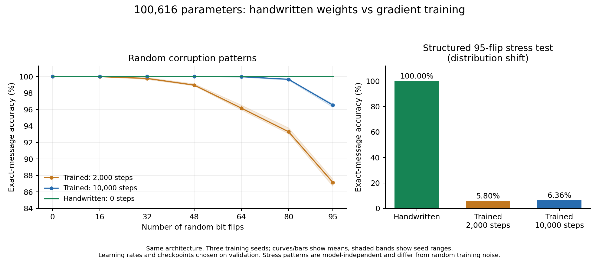

# A fully handwritten 100,616-parameter neural network

This experiment constructs every parameter of a complete neural network once,
without fitting, gradients, an optimizer, pretrained weights, or a search
over candidate weights. Its task is to recover an 8-bit message from a
384-bit encoded transmission containing up to 95 arbitrary bit flips.

The network is an ordinary dense PyTorch MLP:

```text
384 bipolar input bits -> Linear(384, 256) -> ReLU -> Linear(256, 8)
```

Output signs are the recovered message bits, least significant bit first.
All-zero logits indicate an erasure. There are 100,616 stored parameters:
98,304 first-layer weights, 256 hidden biases, 2,048 output weights, and
8 output biases. 100,608 parameters are nonzero; only the eight output biases
are zero. Every hidden unit activates for one of the 256 possible clean
messages. The implementation
uses standard dense layers, with no hidden decoding function in `forward`.

## How the weights solve the problem

Each message describes an affine Boolean function of seven variables.
Evaluate it on all 128 inputs, then transmit that codeword three times.
This is a repeated first-order Reed–Muller code. The underlying code's
minimum-distance formula is documented in the
[SageMath reference](https://doc.sagemath.org/html/en/reference/coding/sage/coding/reed_muller_code.html).
Here the distance is 192 after repetition, which is also checked for every
pair of codewords in the experiment.

Let `C` contain the 256 codewords as rows of bipolar values (-1 or +1),
and `B` contain the corresponding eight message bits as bipolar rows.
The complete weight assignment is:

```text
W1 = C               shape (256, 384)
b1 = -192            shape (256,)
W2 = transpose(B)    shape (8, 256)
b2 = 0               shape (8,)
```

For a received word `x`, the hidden unit for codeword `c` computes
`ReLU(c · x - 192) = ReLU(192 - 2 * HammingDistance(c, x))`.
With at most 95 flips, the true codeword's activation is at least 2.
Every other codeword is at least `192 - 95 = 97` flips away, so its
preactivation is at most -2 and its activation is zero. The output layer
therefore writes exactly the true message's signed bits.

This is a mathematical guarantee over all messages and all corruptions of
at most 95 distinct positions, not an extrapolation from the sampled test
accuracy. At 96 flips there can be a midpoint between two codewords;
the network erases there, and unique decoding is impossible without further
information. The guarantee concerns binary flips, not arbitrary analog noise.

The handwritten construction was fixed before the benchmark. Its weights
were not updated after viewing examples or the training comparisons.

## Comparison protocol

Both approaches use exactly the same 100,616-parameter architecture.
Trained baselines use PyTorch's ordinary random initialization and Adam with
binary cross-entropy on the eight output logits. Training samples draw
messages uniformly, a flip count uniformly from 0 through 95, and distinct
flip positions uniformly. Samples are generated online with replacement.

For each of three initialization seeds (0, 1, 2), try initial learning rates
0.001 and 0.003 with cosine decay to one tenth of the initial rate. Choose
the checkpoint and learning rate by independent validation whole-message
accuracy, breaking ties by lower validation BCE. Validation has 512 examples
at each of seven error counts. Test examples are only constructed after all
training choices have been saved.

Two budgets are retained: 2,000 and 10,000 optimizer steps, batch size 256.
The longer comparison was chosen while validation accuracy was still rising,
before reading the short run's test metrics. The 10,000-step budget gives
each trial 2.56 million training draws: 15.36 million across six trials.

The primary test has 4,096 balanced-message examples at each error count
0, 16, 32, 48, 64, 80, and 95 (28,672 total). Corruptions use a separate seed
from training and validation. Messages are shared across splits; corruption
patterns are independently sampled. This tests new corruptions, not unseen
message identities. The primary aggregate weights the seven error counts
equally; training uses a uniform distribution over all 96 counts.

A separate distribution-shift stress test takes every ordered pair of
codewords at distance 192 and flips the first 95 differing positions toward
the rival: 65,024 examples. It is generated without consulting model outputs.
Its highly structured corruptions differ from the random training noise,
so its accuracy is reported separately. The handwritten model is also
checked on every single-bit flip of every message (98,304 examples).

## Results (2026-11-04)

All accuracies below require the entire eight-bit message to be correct.
Ranges span the three initialization seeds, not confidence intervals.

| Test | Handwritten, 0 steps | Trained, 2,000-step budget | Trained, 10,000-step budget |
|---|---:|---:|---:|
| Random flips, seven severities, 28,672 cases | **100%** | 96.33–96.69% | 99.40–99.48% |
| Exactly 95 random flips, 4,096 cases | **100%** | 86.69–87.55% | 96.29–96.68% |
| Structured 95 flips toward a rival, 65,024 cases (distribution shift) | **100%** | 5.35–6.13% | 5.90–7.11% |
| Every single-bit flip, 98,304 cases | **100%** | Not measured | Not measured |

The 10,000-step selected checkpoints scored 28,524 / 28,499 / 28,523 correct
random-noise cases out of 28,672, for seeds 0 / 1 / 2 respectively. Their
selected learning rates were 0.003 / 0.001 / 0.003 and checkpoint steps were
10,000 / 10,000 / 9,000. All six trials ran their full 10,000-step budget.

The handwritten model built its parameters in approximately 3 milliseconds
after Python/PyTorch imports; the six longer optimizer trials took about
302 seconds total on this CPU, including validation. This timing excludes
the reasoning and engineering effort used to design the construction.
The construction's worst-case correctness follows from the distance proof
above, covering approximately 3.57e94 valid corrupted inputs.



The result is a win over these trained baselines, especially on the separately
reported structured corruptions. It does not show that gradient training
could never learn the same decoder.

## Scope

This demonstrates compiling a known algorithm into neural weights and
compares it with specified finite-budget gradient training. The architecture
and code were selected using knowledge of the task. The construction is
equivalent to a conventional bounded-distance decoder; it is not a newly
discovered decoding algorithm or evidence of a general replacement for
training. Other training objectives, curricula, optimizers, or larger budgets
may do better than the tested baselines.

The transmission rate is only 8/384: this example is not a claim about
state-of-the-art communication efficiency. The three repeated blocks are
independently corrupted observations, not unused model inputs.

## Reproduce and use the weights

From this checkout with PyTorch and safetensors installed:

```bash
PYTHONPATH=. python benchmarks/weight_space/handwritten_decoder_job.py \
  --out /tmp/decoder-10k --steps 10000 --eval-every 1000

PYTHONPATH=. python examples/handwritten_decoder.py --message 173 --flips 95

PYTHONPATH=. python examples/handwritten_decoder.py --message 173 --flips 95 \
  --weights /tmp/decoder-10k/handwritten.safetensors
```

The safetensors file also loads into any ordinary
`Sequential(Linear(384,256), ReLU(), Linear(256,8))` with matching state-dict
keys, without importing the project's model constructor. The output is
eight logits; read signs as bits, and treat an all-zero vector as an erasure.

The JSON summaries retain every learning-rate trial, validation history,
selected checkpoints, exact test counts, source hashes, weight hashes,
runtime versions and CPU timings. Training timings include validation.
Construction time is a local wall-clock measurement, not a portable speed
claim. The weights and summaries are produced locally; no paid GPU is used.

Files: `run_2k/` and `run_10k/` contain the complete JSON reports.
`handwritten.safetensors` and `trained_seed{0,1,2}.safetensors` contain the
handwritten and selected longer-run weights. Binary weights are locally
generated, ignored by Git, and reproducible with the commands above.
`artifact_manifest.json` records their SHA-256 hashes.

`sources/` preserves the exact model and benchmark source files hashed by the
experiments. The delivered model subsequently gained `typing.cast` annotations
for its Linear layer references so the standalone mypy check passes; this
changes no tensor operation. `verification.json` records both source hashes
and checks exact equality of the handwritten tensors and the three random
initializations against the experiment version.
