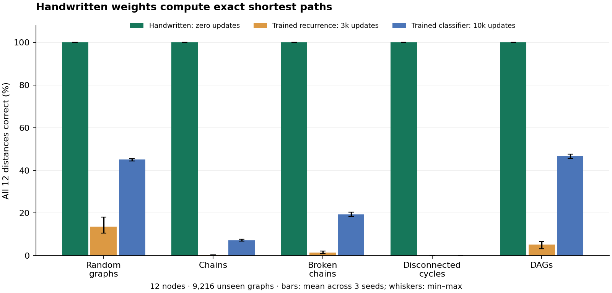

# Handwritten weights for exact directed shortest paths

A second construction after the error-correcting decoder: a standard neural
network now executes an eleven-round graph algorithm. It takes a binary directed
twelve-node graph and one starting node, then returns the shortest hop distance to
every node. Distance 12 means unreachable; the starting node has distance zero.

The full network's weights are set analytically with **zero optimizer updates**.
It stores **114,984 unique dense parameters, of which 1,308 are nonzero**.
One shared block is reused eleven times. Forward evaluation consists entirely of
ordinary PyTorch `Sequential`, `Linear`, and `ReLU` modules. BFS is used only as an
independent label oracle in the benchmark. No graph-specific weight changes or
lookup tables are used. The 100k count describes dense storage, not 100k independent
nonzero instructions; the compiled circuit is sparse.

## Measured results

A graph counts as correct only when **all twelve distances** match the reference.
Ranges below are minimum–maximum over three initialization seeds, after learning
rate and checkpoint selection on validation alone; these are not confidence intervals.

| Evaluation family | Cases | Handwritten | Trained same recurrence | Trained classifier MLP |
|---|---:|---:|---:|---:|
| Random graphs | 5,120 | 100% | 10.68–18.14% | 44.38–45.57% |
| Chains | 1,024 | 100% | 0.20–0.39% | 6.84–7.81% |
| Broken chains | 1,024 | 100% | 0.88–2.15% | 18.55–20.51% |
| Disconnected cycles | 1,024 | 100% | 0.00–0.00% | 0.00–0.10% |
| DAGs | 1,024 | 100% | 3.22–6.74% | 45.61–47.66% |

The handwritten network's maximum raw floating-point error is also zero on every
family: rounding does not conceal approximation error. It additionally passes all
**16,384 graph/source cases** for every loopless directed four-node graph embedded
at nodes 0, 4, 8, and 11 inside the twelve-node model (other nodes isolated).
This exhaustive set is a correctness check, separate from the disjoint test split.



## Architecture and correctness proof

For n nodes, let A be the adjacency matrix and s the starting node. The initial
state is `[flatten(A), one_hot(s), zeros(n), zeros(n)]`, dimension n²+3n.
Write an intermediate state as `[A,p,q,c]` and let r=p−q.
For valid states r is a binary indicator for nodes reachable within the current
number of edges. A block has shape `(n²+3n) -> (2n²+2n) -> (n²+3n)` with ReLU
after each linear layer. The handwritten coefficients implement:

1. `z[i,j] = ReLU(A[i,j] + r[i] − 1)`: binary edge AND reachability.
2. `t[j] = r[j] + sum_i z[i,j]`.
3. Output `[A, t, ReLU(t−1), c+r]`.

Since t is a nonnegative integer, `t−ReLU(t−1)` is exactly its nonzero indicator.
Consequently r at round k marks exactly the nodes reachable in at most k edges,
and c is the sum of the preceding rounds' reachability indicators. The initial
round is k=0; after n−1 blocks, the final linear readout is `n−c−p+q`, equivalently
`n−sum_{k=0}^{n−1} r_k`. If a node's shortest distance is d, it is reachable in
exactly n−d of those rounds, so the output is d. If unreachable it is 0 in every
round, so the output is n. Every reachable node has a simple path of at most n−1
edges. Cycles and self-loops therefore cause no problem.

This argument covers all binary directed twelve-node graphs and all sources.
The benchmark excludes self-loops; even that domain has 2^132 different graphs.
For n=12 every intermediate value is a small integer representable exactly in
float32. There is no precision-sensitive threshold on an arbitrary real input.

The unique parameter count is
`2*180*312 + 312 + 180 + 12*180 + 12 = 114,984`.
The final readout is `180 -> 12`. Expanding the shared block eleven times does
not multiply the unique parameter count. Reducing to ten rounds fails an eleven-edge
chain; the unit test also checks that removing a chain edge changes reachability.
The constructor supports other n by generating a new size-specific model; this is
not a claim that the same twelve-node checkpoint accepts larger graphs.

## Training comparison and split discipline

- Training: 32,760 distinct adjacency matrices, equally drawn from five directed
  Bernoulli edge-density families (p = .025, .05, .1, .2, .4), no self-loops.
- Validation: 1,280 graphs from the same five families.
- Test: 5,120 graphs from those families plus 1,024 each of chains, broken chains,
  disconnected pairs of cycles, and randomly relabeled DAGs: 9,216 total.
- Adjacency matrices are unique across all three splits, even when the source
  differs. Duplicate rejection conditions the Bernoulli samples on uniqueness,
  especially at the sparsest density. Hashes and seeds are saved in `summary.json`.
- Chain node labels are randomly permuted; approximately half of sources are at
  the beginning and half at a random chain position. Broken chains remove one
  edge. Two-cycle graphs have disconnected components. DAGs are sampled at edge
  probability .25 above a randomly ordered diagonal. Structured families are
  distribution-shift probes, not part of training or model selection.
- Same-recurrence baseline: 114,984 parameters, Kaiming initialization for the
  ReLU block and Xavier readout, zero biases, Adam for 3,000 updates with batch
  size 128 (384,000 sampled examples). Loss is MSE with distances divided by 12.
- Classification baseline: a conventional `156 -> 367 -> 156` ReLU MLP,
  115,027 parameters, using 13 distance classes per node and cross entropy.
  It gets the same adjacency and source information, trained for 10,000 updates
  with batch size 128 (1,280,000 sampled examples).
- Both use three seeds, two initial learning rates (.001, .003), cosine decay to
  one tenth of the initial rate, gradient norm clipping at 1, and validation
  every 500 updates. All coefficients, including initially zero ones, may train.
  Per seed, the best checkpoint and rate maximize validation whole-graph accuracy,
  breaking ties with lower distance MAE. All twelve trial histories are retained.
- Test labels and performance are computed after every training trial finishes.
  Trial budgets, architectures, graph families and seeds were fixed before the
  full run. A separate 20-step smoke run checked execution using smaller splits.
- Labels come from queue BFS. A second implementation, NetworkX, independently
  verifies **all 9,216 saved test labels**. Reloading all seven checkpoint files
  reproduces every saved test metric. See `verification.json`.

These experiments demonstrate that a known algorithm can be compiled into neural
weights and outperform these specified finite-budget training recipes. They do
not establish that training cannot learn the algorithm, or beat a tuned graph
neural network, intermediate-state supervision, or larger training budgets.
Architecture and analytic knowledge favor the construction; the comparison does
not account for the human/LLM effort needed to design it. Construction time is
not total development time. This is also not a speed claim against ordinary BFS,
which is a more direct implementation of the same task.

The focused regression suite passes 283 tests, including both handwritten models,
existing weight-space tools, layering, and lazy-torch-import checks. The new model
also passes mypy; the new code passes Ruff, Black, and isort checks.

## Reproduce and use

From the repository root, with torch and safetensors installed:

```bash
PYTHONPATH=. python examples/handwritten_shortest_paths.py --cut-edge 5
PYTHONPATH=. python examples/handwritten_shortest_paths.py --weights benchmark_results/weight_space/20261104_handwritten_graph/handwritten.safetensors
PYTHONPATH=. python benchmarks/weight_space/handwritten_graph_job.py --out /tmp/handwritten-graph-reproduction
```

The benchmark's default arguments reproduce the recorded configuration. The output
directory must be new. CPU run: Python 3.12.12, torch 2.11.0+cu130,
two threads, deterministic algorithms. Bitwise reproducibility across different
hardware/library versions is not guaranteed. Binary checkpoints and the saved
inputs/labels are available in this local evidence directory and follow the
repository's existing ignored-binary policy. The recipe regenerates them.

Use `safetensors.torch.load_model`, rather than loading a duplicated state dict,
to restore the recurrent model's shared weights. All seven checkpoint files,
`evaluation.safetensors`, exact source snapshots, result JSON, and chart files
are recorded by SHA-256 in `artifact_manifest.json`.

## Harder problems to pursue

The same construction method is plausible wherever a bounded algorithm can be
expressed using arithmetic and piecewise-linear gates. These are proposals, not
results from this experiment:

| Next problem | What it adds | Useful proof/evaluation target |
|---|---|---|
| Positive integer weighted shortest paths | Competing path costs; min-plus updates | Exact distances and a valid route under held-out costs and topology |
| Multi-digit multiplication and division | Long carries, conditional subtraction, reusable arithmetic circuits | Exhaustive small operands plus adversarial full-width carry chains |
| Stable sorting / top-k with indices | Comparisons and routing of both values and identities | Duplicates, ties, reversed inputs and permutation checks |
| Bounded 0/1 knapsack | Dynamic programming with capacity and global tradeoffs | Exact optimum and feasible selected items against exhaustive small cases |
| Bounded parsing / balanced nested structures | State, nesting and symbol-dependent transitions | Exhaustive short strings and unseen maximal-depth compositions |

Weighted shortest paths is the most direct next extension. An informative later
experiment would compose separately verified arithmetic, comparison and routing
circuits, then compare that modular construction against strong trained baselines.
Parameter size and depth must be derived per task; a fixed 100k budget is not
assumed to fit every example. Established algorithmic-learning benchmarks offer
useful task definitions: [DeepMind CLRS](https://github.com/google-deepmind/clrs)
and its [benchmark paper](https://proceedings.mlr.press/v162/velickovic22a.html).
This run is our own graph suite, not a CLRS benchmark result.
