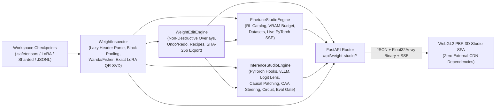

# StateSet 3D Weight Studio — Reference Manual & API Guide

StateSet 3D Weight Studio (`stateset_agents.weight_studio`) is a self-contained, browser-based 3D neural weight explorer, surgical weight editor, mechanistic interpretability bench, and RL finetuning studio packaged directly inside `stateset-agents`.

For a step-by-step hands-on tutorial, start with [`docs/GETTING_STARTED_STUDIO.md`](GETTING_STARTED_STUDIO.md).

---

## Architecture Overview



### Design Principles

- **Zero Eager Heavy Imports:** All `torch` and `transformers` imports inside `stateset_agents/weight_studio/` are strictly lazy inside function bodies so the package respects `tests/unit/test_torch_import_policy.py` and starts fast even on CPU-only environments.
- **Non-Destructive By Construction:** Edits are layered in memory per `(model_id, checkpoint_id)` session. Original checkpoints are never overwritten; verified exports always write to a new directory under `outputs/weight_studio_exports/` with SHA-256 reload verification.
- **Stable v1 API Isolation:** Weight Studio routes live under `/studio` and `/api/weight-studio/*`, keeping the frozen `/v1/*` and `/api/v1/*` compatibility contract untouched.
- **Zero-Dependency WebGL2 Frontend:** The entire 3D engine and UI (`stateset_agents/weight_studio/static/`) uses pure ES modules and custom GLSL ES 3.00 shaders with no external build step or CDN calls.

---

## 3D Topologies & Optical Pipeline

### Five Interactive 3D Topologies

| Mode | Shortcut | Description |
| :--- | :---: | :--- |
| **Architecture 3D** (`stack`) | `1` | Full transformer layer stack on a precision optical bench. Each layer chassis displays miniature weight relief blocks for Self-Attention, Linear-Attention/Mamba, and MLP tensors, linked by residual rails and animated signal conduits. Supports LoRA target-module isolation and live forward/backprop wave pulses. |
| **Microscope 128²** (`microscope`) | `2` | High-density 3D crystal matrix of any selected 2D weight tensor (up to **128×128 = 16,384 crystals** streamed via binary `Float32Array`). Includes 3D Surgical Brush painting, deep-zoom sub-region cropping, GQA attention-head divider planes (`H0..Hn`), Pre-Edit Ghost overlays, extreme outlier beacons, and real-time **Split A\|B** scissor-pass wipe comparison. |
| **SVD Spectral** (`spectral`) | `3` | Decomposes any 2D tensor or LoRA pair (`B @ A` via exact QR-trick without materializing dense matrices) into Factor `A`/`Vᵀ`, Factor `B`/`U`, a 3D singular value bar spectrum `Σ` with a glowing interactive rank-`k` laser cutoff plane, and live rank-`k` 3D reconstruction. |
| **Trajectory 4D** (`trajectory`) | `4` | Multi-checkpoint evolution terrain plotting layer Frobenius norms (or deltas) across training steps (`step-100`, `step-200`, …, `Final`) with a glowing timeline scanner plane and play/pause timelapse playback. |
| **Circuit 3D** (`circuit`) | `5` | Automated causal circuit topology showing prompt token monoliths on the input bus, elevated transformer stages with individual Attention Head pillars and MLP cores, an output unembedding prism, and multi-color 3D cubic Bezier attention-flow ribbons with animated directional photon packets. |

### WebGL2 PBR Graphics Stack

Implemented in [`shaders.js`](../stateset_agents/weight_studio/static/js/shaders.js) and [`renderer.js`](../stateset_agents/weight_studio/static/js/renderer.js):

- **Cook-Torrance GGX PBR Shading** with procedural HDR studio softbox IBL and chamfered beveled crystal geometry.
- **1024×1024 PCF Soft Shadow Maps** (`SHDW`) cast from the key studio softbox across crystal towers and the anodized floor.
- **Real-Time Planar Floor Reflections** (`REFL`) via a half-resolution Y-mirrored camera pass blended with brushed anodized floor micro-grain.
- **Depth-Crevice SSAO** (`SSAO`), toggleable **Optical Bokeh Depth-of-Field** (`DOF`), **Dual-Tier Separable Gaussian Bloom**, and **ACES Filmic Tonemapping**.
- **60 FPS GPU Liquid-Crystal Morphing** that smoothly interpolates crystal heights and colors whenever weights change via surgical editing, checkpoint scrubbing, or live PyTorch finetuning.
- **4 Studio Lighting Rigs:** `obsidian` (Obsidian Lab), `copper` (Copper Forge), `photonics` (Deep Photonics), and `cleanroom` (Cleanroom White).
- **7 Scientific Colormaps:** `signed` (`±`), `magnitude` (`|W|`), `delta` (`ΔW`), `importance` (Wanda/Fisher salience), `conflict` (Adapter A vs. B sign conflict), `gradient` (Thermal Heat), and `outlier` (Z-score).

---

## Surgical Weight Editing Reference

Implemented in [`stateset_agents/weight_studio/editor.py`](../stateset_agents/weight_studio/editor.py).

### Target Selectors

| Selector | Scope |
| :--- | :--- |
| `<exact_tensor_name>` | Single named tensor |
| `layer:<n>` or `layer:<lo>-<hi>` | All tensors in layer `n` (or inclusive range `lo..hi`) |
| `role:self_attn` / `role:linear_attn` / `role:mlp` / `role:norm` / `role:embedding` | All tensors matching an architectural role |
| `suffix:<substring>` | Any tensor whose name contains `<substring>` (e.g. `suffix:q_proj`) |
| `all` | Every tensor in the checkpoint |

### Supported Operations (`op`)

| `op` | Key `params` | Behavior & Diagnostics |
| :--- | :--- | :--- |
| `scale` | `{"factor": 1.25}` | Multiplies target tensor(s) by `factor`. |
| `prune` | `{"mode": "wanda" \| "percentile", "sparsity": 0.35}` | Zeros the lowest-salience fraction of weights using Wanda+Fisher importance (`wanda`) or raw magnitude (`percentile`). |
| `clamp` | `{"mode": "percentile", "percentile": 99.0}` | Symmetric clamping at the specified absolute percentile (or `{"mode": "value", "max_abs": 0.1}`). |
| `svd_truncate` | `{"rank": 8}` | Low-rank SVD truncation retaining top-`rank` singular components. |
| `head_edit` | `{"head_index": 0, "num_heads": 8, "axis": 0, "action": "ablate" \| "scale" \| "prune" \| "invert", "value": 0.5}` | Surgically edits a single GQA attention head slice. |
| `rank1_edit` | `{"subject": "...", "target_fact": "...", "strength": 0.65, "regularization": 0.1}` | ROME/MEMIT-style rank-1 associative update `W' = W + s·((v* - Wk)kᵀ)/(‖k‖² + λ)` with 12-probe orthogonal drift check (`protected_mean_cosine`, `drift_passed`). |
| `steer_bake` | `{"concept": "...", "strength": 0.75, "direction": [...]}` | Bakes an extracted Contrastive Activation Steering (CAA) vector directly into 2D weights as a rank-1 projection with protected-prompt drift verification. |
| `region_edit` | `{"row_start": 0, "row_end": 16, "col_start": 0, "col_end": 16, "action": "zero" \| "scale" \| "invert" \| "clamp", "value": 0.25}` | Edits an exact rectangular sub-matrix painted with the 3D Brush. |
| `blend` | `{"secondary_model_id": "...", "method": "ties" \| "dare" \| "slerp" \| "linear", "alpha": 0.5, "density": 0.65, "drop_rate": 0.35}` | Multi-checkpoint / multi-adapter merging; `ties` reports exact sign `conflict_rate`. |
| `noise` | `{"sigma": 0.01, "seed": 42}` | Deterministic Gaussian perturbation. |

### Portable Edit Recipes (`.studio-recipe.json`)

Export an active edit stack (`GET /api/weight-studio/edits/recipe?model_id=...`) to obtain a portable JSON recipe:

```json
{
  "schema_version": 1,
  "format": "stateset-weight-studio-recipe",
  "source_model_id": "local:outputs/my_lora_run",
  "source_base_model": "Qwen/Qwen3.5-9B",
  "source_checkpoint_id": "default",
  "operations": [
    {
      "op": "prune",
      "target": "role:mlp",
      "params": {"mode": "wanda", "sparsity": 0.3},
      "label": "Wanda Prune 30%"
    },
    {
      "op": "steer_bake",
      "target": "layer:14",
      "params": {"concept": "Empathetic Resolution", "strength": 0.75, "direction": [0.12, -0.34]},
      "label": "Bake CAA 'Empathetic Resolut' (L14, α=+0.75)"
    }
  ]
}
```

Replay it deterministically onto any compatible checkpoint via the UI (`↑ Replay`) or API (`POST /api/weight-studio/edits/recipe/apply`).

---

## REST, Binary & Streaming API Reference

All endpoints are mounted under `/api/weight-studio` (both in standalone mode and when mounted onto `stateset_agents.api.main`).

### Discovery & Inspection

| Method | Endpoint | Purpose |
| :--- | :--- | :--- |
| `GET` | `/api/weight-studio/health` | Studio status, active workspace path, static bundle readiness. |
| `GET` | `/api/weight-studio/models?refresh=false` | List discovered local `.safetensors` models/adapters and preset twins. |
| `GET` | `/api/weight-studio/models/structure?model_id=...` | Full layer tree, role tags, miniature 3D grids, norms, and edit history. |
| `GET` | `/api/weight-studio/models/tensor?model_id=...&tensor_name=...&resolution=64` | Detailed tensor statistics, histogram, outliers, GQA head info, and SVD factors. |
| `GET` | `/api/weight-studio/models/tensor.bin?model_id=...&tensor_name=...&resolution=128` | High-speed binary `Float32Array` payload (`values`, `delta`, `importance`, `conflict`) with `X-Tensor-Meta` JSON header for up to 128×128 Microscope views. |
| `GET` | `/api/weight-studio/models/trajectory?model_id=...` | Multi-checkpoint norm & delta evolution matrix for `Trajectory 4D`. |

### Surgical Editing, Recipes & Verified Export

| Method | Endpoint | Purpose |
| :--- | :--- | :--- |
| `POST` | `/api/weight-studio/edits/apply` | Apply any surgical edit (`scale`, `prune`, `clamp`, `svd_truncate`, `head_edit`, `rank1_edit`, `steer_bake`, `region_edit`, `blend`, `noise`). |
| `POST` | `/api/weight-studio/edits/undo` | Undo the most recent edit in the active session. |
| `POST` | `/api/weight-studio/edits/redo` | Redo the last undone edit. |
| `POST` | `/api/weight-studio/edits/toggle` | Enable/disable a specific `edit_id` and recompute overlays cleanly. |
| `POST` | `/api/weight-studio/edits/reset` | Clear all non-destructive edits back to the base checkpoint. |
| `GET` | `/api/weight-studio/edits/recipe?model_id=...` | Export active enabled edits as a portable `.studio-recipe.json`. |
| `POST` | `/api/weight-studio/edits/recipe/apply` | Deterministically replay a recipe JSON onto a target model/checkpoint. |
| `POST` | `/api/weight-studio/edits/export` | Write immutable `.safetensors`, verify exact reload + SHA-256 `edit_manifest.json`, and optionally run `merge_adapter` key-remap & `merge_probe.json` verification. |

### Finetuning Workbench & Live Streaming

| Method | Endpoint | Purpose |
| :--- | :--- | :--- |
| `GET` | `/api/weight-studio/finetune/catalog` | Supported RL algorithms (`GSPO`, `GRPO`, `DAPO`, `GEPO`, `VAPO`, `PPO`, `SFT`) and GPU provider specs. |
| `GET` | `/api/weight-studio/finetune/datasets` | Discover local `.jsonl` training datasets and curated reward traces. |
| `GET` | `/api/weight-studio/finetune/datasets/inspect?path=...` | Preview rows, token lengths, and mean reward scores for a dataset. |
| `GET` | `/api/weight-studio/finetune/workspace-runs` | List prior training runs in the workspace. |
| `POST` | `/api/weight-studio/finetune/estimate` | Compute VRAM breakdown, trainable parameter percentage, provider cost, schema validation, and reproducible `stateset-agents` CLI command. |
| `POST` | `/api/weight-studio/finetune/start` | Launch a live PyTorch AdamW micro-finetuning job against active LoRA/layer tensors. |
| `GET` | `/api/weight-studio/finetune/stream/{job_id}` | Server-Sent Events (SSE) stream of per-step loss, reward, KL, and layer gradient norms. |
| `WS` | `/api/weight-studio/finetune/ws/{job_id}` | Optional WebSocket mirror of the live finetuning stream. |
| `POST` | `/api/weight-studio/finetune/jobs/{job_id}/{pause,resume,stop}` | Live lifecycle controls for running micro-finetuning jobs. |

### Inference, Logit Lens, Causal Patching, Steering, Circuits & Eval Gate

| Method | Endpoint | Purpose |
| :--- | :--- | :--- |
| `GET` | `/api/weight-studio/inference/scenarios` | Built-in StateSet support, tool-calling, RLVR math, and safety boundary scenarios. |
| `POST` | `/api/weight-studio/inference/run` | Execute forward pass (PyTorch hooks, remote vLLM, or weight probe) with Base-vs-Edited A/B diff, Token & Layer-by-Layer Logit Lens, `causal_patches`, and live `steering`. |
| `POST` | `/api/weight-studio/inference/circuit` | Discover Top-K causal attention heads & MLP cores and generate 3D attention-flow arcs for `Circuit 3D`. |
| `GET` | `/api/weight-studio/steering/presets` | Built-in StateSet contrastive behavioral steering pairs. |
| `POST` | `/api/weight-studio/steering/extract` | Extract layer-wise contrastive steering vectors `v_ℓ = h_ℓ(pos) - h_ℓ(neg)` and select optimal injection layer. |
| `POST` | `/api/weight-studio/steering/bake` | Permanently bake an extracted steering vector into target layer weights as an undoable surgical edit. |
| `POST` | `/api/weight-studio/eval/run` | Run the Pre-Export Batch Eval Gate (`GO` / `WARN` / `BLOCK`) comparing Base vs. Edited across dataset traces and built-in suites. |

---

## Programmatic Python Usage

### Standalone or Embedded FastAPI App

```python
from pathlib import Path
from fastapi import FastAPI
from stateset_agents.weight_studio import create_studio_app, mount_studio_ui

# Option A: Standalone FastAPI app
studio_app = create_studio_app(workspace_root=Path("."))

# Option B: Mount onto your existing FastAPI application
app = FastAPI()
mount_studio_ui(app)  # serves /studio and /api/weight-studio/*
```

### Headless Python Scripting (Inspection, Surgery, Steering & Eval Gate)

```python
from pathlib import Path
from stateset_agents.weight_studio import StudioRuntime

rt = StudioRuntime(workspace_root=Path("."))
models = rt.inspector.list_models()
model_id = models[0]["model_id"]

# 1. Extract a Contrastive Activation Steering vector
presets = rt.inference.list_steering_presets()
vec = rt.inference.extract_steering_vector(
    model_id,
    presets[0]["positive"],
    presets[0]["negative"],
    name=presets[0]["name"],
)

# 2. Apply surgical edits (Wanda pruning + steering bake)
rt.editor.apply_edit(model_id, "prune", "role:mlp", {"mode": "wanda", "sparsity": 0.25})
rt.editor.apply_edit(
    model_id,
    "steer_bake",
    f"layer:{vec['recommended_layer']}",
    {"concept": vec["name"], "strength": 0.7, "direction": vec["direction"]},
)

# 3. Run the Pre-Export Batch Eval Gate before saving
gate = rt.inference.run_batch_eval(model_id, max_cases=6)
print("Gate verdict:", gate["verdict"], gate["verdict_reason"])

# 4. Export a SHA-256 reload-verified .safetensors checkpoint + portable recipe
if gate["verdict"] == "GO":
    manifest = rt.editor.export_verified_checkpoint(
        model_id, "verified-surgical-v1", run_merge_probe=True
    )
    recipe = rt.editor.export_recipe(model_id)
    print("Exported:", manifest["export_file"], "SHA-256:", manifest["sha256"][:16])
```

---

## Module Layout

| File | Responsibility |
| :--- | :--- |
| [`stateset_agents/weight_studio/__init__.py`](../stateset_agents/weight_studio/__init__.py) | Lazy package exports (zero eager `torch` import). |
| [`stateset_agents/weight_studio/__main__.py`](../stateset_agents/weight_studio/__main__.py) | Standalone `python -m stateset_agents.weight_studio` CLI entrypoint. |
| [`stateset_agents/weight_studio/inspector.py`](../stateset_agents/weight_studio/inspector.py) | Fast `.safetensors` header discovery, sharded index loading, block pooling, Wanda/Fisher salience, GQA head inference, LoRA QR-SVD, binary payload packing. |
| [`stateset_agents/weight_studio/editor.py`](../stateset_agents/weight_studio/editor.py) | Non-destructive edit overlay engine, undo/redo/toggle, recipes, SHA-256 reload-verified export, `merge_adapter` probe. |
| [`stateset_agents/weight_studio/finetune_engine.py`](../stateset_agents/weight_studio/finetune_engine.py) | RL objective catalog, dataset inspector, VRAM/cost estimator, `finetune_workspace` validation, live PyTorch AdamW SSE trainer. |
| [`stateset_agents/weight_studio/inference_engine.py`](../stateset_agents/weight_studio/inference_engine.py) | Real PyTorch forward hooks, remote vLLM probe, Logit Lens, Causal Patching, CAA Steering extraction, Causal Circuit discovery, Batch Eval Gate. |
| [`stateset_agents/weight_studio/router.py`](../stateset_agents/weight_studio/router.py) | FastAPI router, schemas, static SPA mounting, `create_studio_app()`. |
| [`stateset_agents/weight_studio/static/`](../stateset_agents/weight_studio/static/) | Custom WebGL2 PBR renderer (`renderer.js`, `shaders.js`, `math3d.js`, `charts.js`, `app.js`, `index.html`, `styles.css`). |
| [`tests/unit/test_weight_studio.py`](../tests/unit/test_weight_studio.py) | Unit and FastAPI integration test suite covering all Studio v1–v3 features. |
